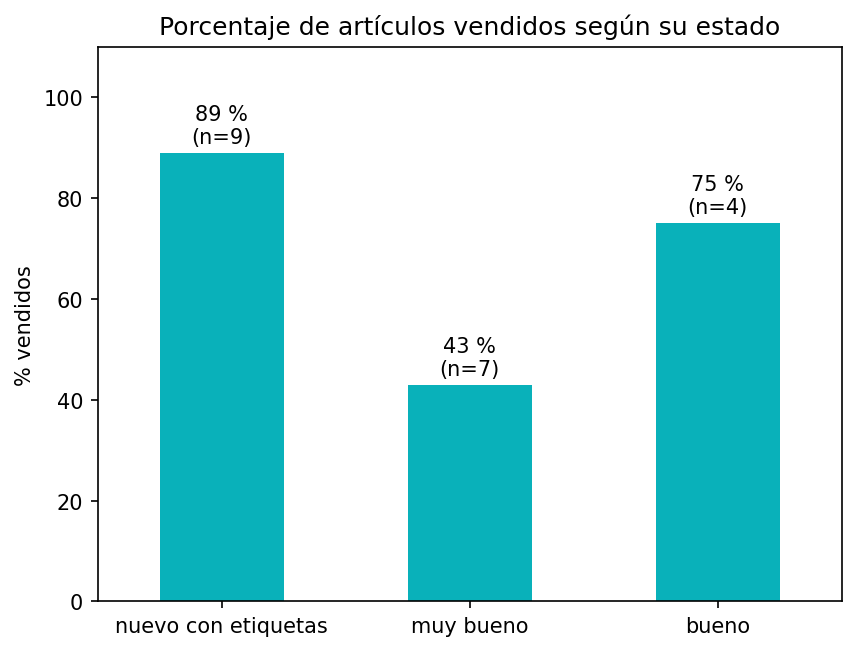

# Análisis de mis ventas en Vinted

Análisis de 20 artículos que he publicado en Vinted (octubre-noviembre de 2026), registrados por mí misma en una hoja de cálculo. El objetivo es descubrir qué factores influyen en que un artículo se venda.

## Principales hallazgos

- **El precio no explica qué se vende**: lo vendido y lo no vendido cuesta casi lo mismo, pero lo vendido tiene unas 5 veces más visitas.
- **Lo nuevo con etiquetas es lo que mejor se vende**: 89 %, frente a 75 % en «bueno» y 43 % en «muy bueno».
- **Las marcas de Inditex se venden algo más**: 80 % frente a 67 %, aunque con solo 5 artículos es una pista, no una conclusión.

## Herramientas

Python (pandas, matplotlib) en Google Colab, con Claude como apoyo para el aprendizaje.

## Próximos pasos

- Seguir registrando ventas para estudiar el efecto de la temporada.
- Construir un agente de IA que ayude a redactar anuncios y sugerir precios a partir de estos datos.
